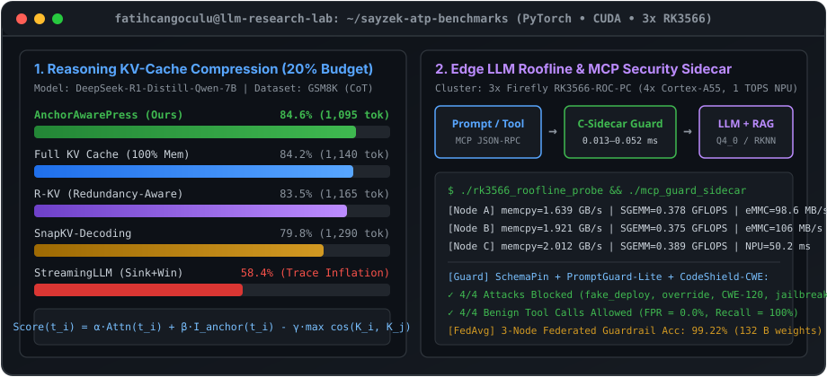

<div align="center">

<!-- HEADER LINE -->


<br/>

<h1>👋 Fatih Can Göçülü</h1>

<!-- TYPING SVG -->


<br/><br/>

<!-- SOCIAL & PROFILE BADGES -->
<a href="https://github.com/fatihcangoculu">
  
</a>&nbsp;
<a href="https://github.com/fatihcangoculu/edge-llm-security-and-kv-bench">
  
</a>&nbsp;
<a href="https://github.com/fatihcangoculu?tab=repositories">
  
</a>&nbsp;


</div>

---

```yaml
╔══════════════════════════════════════════════════════════╗
║                   🧠  WHO AM I?                          ║
╚══════════════════════════════════════════════════════════╝

name        : Fatih Can Göçülü
role        : Software & AI Systems Engineer | MSc Researcher (LLMs)
location    : Türkiye 🇹🇷
focus       : Efficient LLM Inference, KV-Cache Compression & AI Security

core_skills:
  - llm_systems: KV-Cache Eviction (KVPress, R-KV, SnapKV), RoPE/Attention Calibration, GGUF/llama.cpp
  - ai_security: LlamaFirewall, PromptGuard 2, CodeShield, MCP Tool-Call Guardrails, Semgrep, SonarQube
  - languages  : Python (PyTorch/Transformers), C/C++ (Edge & System Sidecars), TypeScript, Bash, SQL
  - hardware   : CUDA GPUs, 3x Firefly Rockchip RK3566-ROC-PC (4x Cortex-A55 + 1 TOPS RKNPU)

currently:
  - 🔭 Working on : Anchor-Aware Training-Free KV Cache Compression for Reasoning LLMs
  - 🛡️ Researching: Sub-millisecond C-Sidecar Guardrails & Long-Context Positional Calibration
  - 🧪 Lab Setup  : 3-Node Embedded RK3566 Cluster + PyTorch Reasoning Evaluation Harness
  - 🎯 Goal 2026  : High-impact MSc Thesis & Open-Source Defense/Industrial LLM Tooling

philosophy  : "Measure first, compress smartly, secure by design."
```

---

## 📊 LLM Research & Hardware Lab Snapshot

<div align="center">
  
</div>

---

## 🎖️ About Me

I am a **Software & AI Systems Engineer** and **MSc Researcher** focusing on **resource-constrained Large Language Models (LLMs)** and **AI cybersecurity**. My graduate research investigates how to run reasoning-capable and long-context LLMs reliably under strict memory and latency budgets — combining **training-free KV cache compression (`AnchorAwarePress`)**, **length-adaptive positional hidden-state calibration (`PositionalHidden`)**, and **sub-millisecond C security sidecars (`LlamaFirewall` / MCP Guard)** validated across both GPU environments and a physical **3-node Firefly Rockchip RK3566** embedded cluster.

---

## 🛠️ Technology Arsenal

<div align="center">

**🧠 LLM & Deep Learning Stack**


**🛡️ AI Security, Guardrails & Static Analysis**


**💻 Programming Languages**


**🧰 Embedded Edge, DevOps & Infrastructure**


</div>

---

## 🔬 Active LLM Research Repositories

```text
📌 edge-llm-security-and-kv-bench →  Anchor-Aware KV Compression + 3x RK3566 Roofline & MCP C-Sidecar
⚡ kvpress (Fork + Extension)     →  Structural Anchor-Aware ScorerPress for CoT Reasoning Models
🛡️ PurpleLlama (Fork + Extension) →  LlamaFirewall Bilingual (TR/EN) Injection & Edge C-Sidecar Eval
📐 PositionalHidden (Extension)   →  Dynamic Length-Adaptive (L / L_max) Hidden Channel Calibration
🔧 llama.cpp (Fork + Profiling)   →  Rockchip RK3566 (4x Cortex-A55) DRAM & SGEMM Roofline Probe
```

---

## 📈 GitHub Analytics & Activity

<div align="center">


</div>

<div align="center">


</div>

---

## 🎯 Core Competencies

| Domain | Technologies & Methods | Level |
|--------|------------------------|-------|
| 🧠 **LLM KV-Cache & Reasoning** | Training-Free Eviction (`KVPress`, `R-KV`, `SnapKV`), CoT Anchor Retention | ⬛⬛⬛⬛⬛⬛⬛⬛⬛⬜ Advanced |
| 📐 **Long-Context & RAG** | Lost-in-the-Middle Mitigation, Positional Channel Scaling, Faithfulness | ⬛⬛⬛⬛⬛⬛⬛⬛⬜⬜ Advanced |
| 🛡️ **LLM & Agent Security** | `LlamaFirewall`, `PromptGuard 2`, MCP Schema Pinning, CWE Static Analysis | ⬛⬛⬛⬛⬛⬛⬛⬛⬛⬜ Advanced |
| 🔧 **Edge AI & Embedded Linux** | 3x Firefly `RK3566`, `llama.cpp`, `GGUF` Quantization, Roofline Profiling | ⬛⬛⬛⬛⬛⬛⬛⬛⬜⬜ Advanced |
| 🧪 **Software Quality & Automation** | E2E QA Gates, SonarQube, Semgrep, GitLab CI/CD Pipelines | ⬛⬛⬛⬛⬛⬛⬛⬛⬛⬜ Expert |

---

<div align="center">


**⚡ Open to collaborating on Efficient LLM Inference, KV-Cache Compression, and Secure AI Agents ⚡**

</div>
